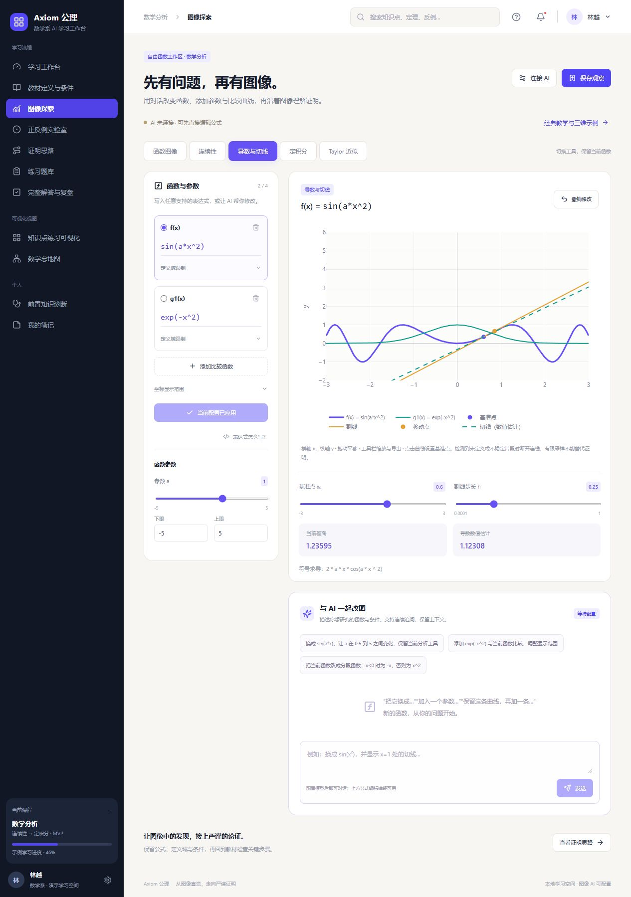
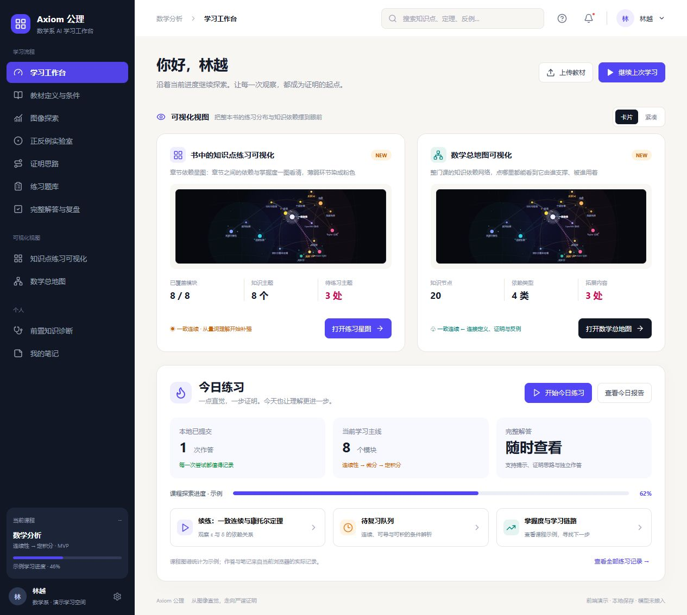

# 前端验证记录

日期：2026-11-02。环境：Windows、Node.js 24.19.0、Codex 内置浏览器。

## 教材整合改版（2026-11-13）

- 主导航收敛为 7 个条目；正反例实验室、证明思路、完整解答与复盘、前置知识诊断不再有独立入口。
- 旧地址兼容：`#explore`/`#examples`/`#proof` 跳转教材学习并为 `#proof` 自动展开证明；`#review` 跳练习；`#diagnostic` 跳教材学习。
- 教材学习首屏显示当前知识点、定义、AI 入口；图像、正例/反例/我的探索、函数/参数/范围编辑、撤销和 AI 改图在教材内联。
- AI 请求携带 `context`（conceptId、章节、定义、案例、contentVersion、selectedProofStep、allowedReferences、sceneVersion），后端 `AIPlotRequest.context` 进入提示词；AI 解释与改图共用同一面板。
- 证明步骤提供“问 AI 这一步”，打开同一面板并携带所选步骤文本；顶部 AI 按钮和图像入口不产生第二套会话组件。
- 证明在定理下按需展开；完整解答与历史作答保留在对应练习题内。
- 实测：教材页首屏 1440×849 可见 AI 按钮；图像 Plotly 正常；AI 解释 `x^2` 的差商并成功改为 `abs(x)`；旧 `#proof` 打开教材且证明折叠展开。
- 后端 **106 passed**，前端 **21/21**；截图 [教材学习首屏](textbook-first-screen.png)、[教材内 AI](textbook-ai.png)、[证明步骤问 AI](textbook-proof-step.png)。
- 免安装包在**全新解压目录**验证：无 `backend/.env`、无 `data/`；启动后 `/api/health` 200、演示账号登录成功、首页 200。发布包 `Axiom-Windows-Full-20261113T153743Z.zip`（44,672,413 字节，4,335 文件）。
- 本次未在 390px 手机视口完成逐项截图验收；响应式 CSS 已提供，但需后续真机复核。

## AI 讨论式练习（2026-11-07）

- 练习页现在是两个按钮：**和 AI 讨论**、**提交答案**。讨论只调用 `/api/v1/ai/exercises/discuss`，不会创建 Attempt；提交才调用 `/api/v1/ai/exercises/submit`，用答案+讨论记录生成最终 AI 评语并写入一条 Attempt。
- 实测讨论：AI 根据错误草稿指出“本题是 f(x)=2|x|，你的 x²/[0,1] 属于另一道题”，并追问左右差商。
- 实测提交：AI 给出 90/100、连续性/左右差商优点、缺失条件和下一步；页面显示“AI 批改”及详情，Attempt 状态为 `ai_reviewed`。
- 后端测试新增讨论不落库、提交落库、AI 反馈字段；**106 passed**；前端 **21/21**。
- 截图：[AI 讨论后提交批改](ai-discussion.png)。

## 教材/证明排版修复（2026-11-07）

- 根因：模块拆分后 `App.tsx` 直接加载 `modules/teaching`，绕过了原 `pages/Learning.tsx` 里的 `learning.css` 导入，导致教材定义、证明、练习页面共用样式丢失。
- 修复：`Textbook`、`Examples`、`Proof`、`Exercises`、`Review` 各自导入 `../learning.css`，不再依赖某个父入口的副作用。
- 实测：教材页恢复为两栏讲义+定义卡；证明页恢复 `260px + 797px` 网格和步骤导航。
- 截图：[教材排版](layout-textbook.png)、[证明排版](layout-proof.png)。
- 修复前备份：`backup/pre-layout-fix-20261107`（tag/branch）；修复后发布标签 `release/2026-11-07-layout-fix`。
- 后端 **106 passed**，前端 **21/21**，在线构建通过。

## 用户接入 DeepSeek（2026-11-07）

- 图像探索和三维曲面页均可打开“接入 DeepSeek”，输入个人 Key、选择 `deepseek-chat` / `deepseek-reasoner`、保存并测试，不需要改 `.env` 或重启后端。
- 后端 `PUT /api/v1/ai/credentials` 保存 Fernet 加密凭据；`GET /api/v1/ai/status` 只返回 `source`、模型和末四位提示；`DELETE` 回退系统默认。
- 真实 Key 实测：保存后 `/api/v1/ai/test` 返回 200、`source=user`、`provider=deepseek`；移除后回到 `source=system`。二维 `/api/v1/ai/plot` 也返回 200，将曲线改为 `cos(x)`。
- UI 实测：表单保存后显示“已接入我的 Key · deepseek-chat · …7890”，移除后恢复“当前使用系统默认模型”。
- 后端新增 `tests/test_ai_credentials.py`（加密、隔离、测试调用、移除）；后端 **106 passed**，前端 **21/21**。
- 截图：[用户接入 DeepSeek](ai-user-key.png)。

## 业务模块拆分（2026-11-07）

- 建立 `frontend/src/modules/`：可视化模块已落地，另五个模块已有边界 README 与数据访问适配器。
- `pages/FunctionWorkspace.tsx` 从 988 行降为兼容导出；实现迁到 `modules/visualization/two-d/FunctionWorkspace.tsx`（76 行组合层）。
- 拆出 `components/`（编辑器、图表、AI 对话、模型设置、下一步）、`hooks/useFunctionWorkspace.ts`（状态/撤销/请求/持久化）、`scene/functionScene.ts`（唯一校验入口）、`api.ts`。
- 三维页面从 `pages/surface/` 迁入 `modules/visualization/three-d/`；`App.tsx` 懒加载路径更新。
- 人工编辑、AI 返回、撤销共用 `applyFunctionScene`；实测公式 `x^2 → sin(x)`、撤销回 `x^2`、AI 改 `cos(x)` 均正常，三维页面 904 个投影路径正常。
- `DataProvider` 从 594 行降到 326 行：练习 `submitAttempt/rateAttempt/loadHint/loadSolution`、记录 `saveNote/deleteNote/toggleBookmark`、进度 `submitDiagnostic` 已迁入模块 hooks；DataProvider 只保留组合、加载、刷新和错误边界。页面入口通过 `modules/teaching|practice|progress|records|identity` 导出。
- 模块边界、接口、数据归属和验收标准见 [`MODULES.md`](../../MODULES.md)、[`docs/contracts.md`](../../docs/contracts.md) 和 [`visualization/README.md`](../src/modules/visualization/README.md)。
- Git 提交：`fd7f6fb`（可视化模块）、`628492d`（模块验收文档）、`5d8459b`（练习/记录/进度 actions 提取）。
- 发布产物：`releases/Axiom-Windows-Full-20261113T153743Z.zip`，44,672,413 字节、4,335 个文件，由 `npm run package:windows` 生成。
- 后端 **106 passed**，前端 **21/21**，`npm run build:online` 与 Windows 打包构建通过。

## 练习批改与稳定本地预览（2026-11-07）

- 练习提交改为“提交批改”：计算题从作答中提取最终表达式，后端 SymPy 等价检查；证明题按关键步骤给 0–100 结构分，返回逐项 ✓/✗、权重、参考结果与人工复核提示。
- 证明题实测：`uniform-3` 的完整结构作答返回 100/100、5 项全部覆盖，页面标注“结构批改”；计算题 `primitive-2` 输入 `F(x)=exp(2*x)*(2*x-1)/4+C` 返回 100/100、“自动批改通过”和参考结果 `x*exp(2*x)`。
- 错误最终表达式返回 0 分与参考结果；无法解析时保留 `needs_review`，不强行判错。
- 新增根目录 `启动本地预览.cmd` / `停止本地预览.cmd`：单端口 `127.0.0.1:8080` 同时提供前端与 API，不依赖隧道、外网或系统代理；实测停止后重新启动、健康检查 200 均正常。
- 后端测试 **106 passed**；前端 **21/21**；在线构建通过。
- 截图：[证明题结构批改](grading-proof.png)、[计算题符号批改](grading-computation.png)。

## 完整 Windows 分享包（2026-11-07）

- 分享包 `Axiom-Windows-Full-20261107T042212Z.zip` 约 41 MB，包含当前前端、完整 Flask 业务后端、Python 3.12.7 嵌入式运行环境与全部必需依赖。
- 使用专用 `dist-portable` 构建目录与同源 API 配置，避免分享版依赖开发机的 8000 端口；默认本机端口为 5186。
- 从 ZIP 解压到独立测试目录，用包内启动文件和 Python 运行，核验 4181 个文件的 SHA-256 全部一致；未复制开发者数据库、`.env`、`.env.online` 或模型密钥。
- 使用临时测试端口 5196：健康检查、演示登录、bootstrap、笔记写入和读回均成功；未配置 AI 时状态如实返回未配置。数据库、配置文件、后端源文件和运行程序均不能通过静态站点路径下载。
- 浏览器通过“演示学生账号快速进入”正常登录；学习工作台、二维自由函数和三维曲面页面正常呈现，截图见 [免安装版运行实拍](portable-full.png)。
- 此次验证没有调用真实模型，也没有使用另一台物理电脑；打包时安装依赖仅写入项目专用缓存，没有修改系统 Python 环境。

## 三维曲面人机协作（2026-11-07）

- 新增“三维曲面实验室”页面：SVG 曲面投影、网格/坐标轴、范围/密度/高度/透明度/配色控制。
- 人工交互实测：拖动改变方位角与俯仰角（45°/28° → 96°/42°），预设按钮把 `x^2+y^2` 切换为 `x^2-y^2`。
- AI 交互实测：DeepSeek `POST /api/v1/ai/surface` 返回 200，将曲面改为 `sin(x)*cos(y)`，视角改为 60°/35°；页面实际更新。
- 撤销、重置、表达式错误保护、AI 失败保留原场景已实现。
- 后端新增 `SurfaceScene`/`SurfaceAIRequest` 与 `compile_surface_expression`；`test_surface_adapter.py` 覆盖表达式校验、未知符号拒绝、mock 三维接口。
- 后端测试 **106 passed**；前端 21/21；构建通过。
- 截图：[三维曲面](3d-surface.png)、[AI 改曲面](3d-surface-ai.png)。

## DeepSeek API 接入（2026-11-06）

- 后端 `AXIOM_AI_PROVIDER=deepseek` 预设：默认 `https://api.deepseek.com` / `deepseek-chat`；支持 `deepseek-reasoner`（自动跳过 `temperature` / `response_format`）。
- 适配器新增 JSON 空内容重试、402 余额不足提示、DeepSeek 错误正文截取；AI 状态返回 `provider_label` / `reasoner` / 有效 `json_mode`。
- 新增 `POST /api/v1/ai/test` 真实连通性测试；前端图像工作区的“连接 AI”面板增加“测试连接”，并给出 DeepSeek 配置示例。
- `backend/tests/test_deepseek_adapter.py` 用模拟 HTTP 响应覆盖 URL、鉴权头、JSON 参数、reasoner 降级和 402；后端 106 项测试通过。
- **真实 DeepSeek 已实测**（2026-11-06）：
  - `/api/v1/ai/test` 200，返回 `provider=DeepSeek`，实际模型 `deepseek-flash`，约 2.2 秒；
  - `/api/ai/plot` 成功把 `x^2` 改为 `sin(x)`，返回的 scene 通过 Pydantic 校验；
  - 在线页面显示 `DeepSeek · deepseek-chat`，设置面板“测试连接”成功；
  - 在页面输入“把函数换成 sin(x)，保留坐标范围”，AI 回复并实际更新公式与图像。
- 截图：[DeepSeek 设置](online-deepseek-settings.png)、[DeepSeek 改图](online-deepseek-chat.png)。

## 在线预览与知识地图紧凑化（2026-11-06）

- 知识地图右侧原来的“值得复习的 N 个节点”大卡片已移除：改为一行 `待复习 N 个节点` 的紧凑条，去掉感叹号图标；顶部“标出待复习”也去掉了感叹号，深色“阅读方式”卡片缩小了内边距和字号。
- 新增同源在线构建 `dist-online`：`VITE_API_BASE=__SAME_ORIGIN__`，前端请求 `/api`，不再依赖 `127.0.0.1:8000`。
- 后端新增认证接口 `GET /api/v1/bootstrap`，一次返回目录、8 个知识点详情、32 道练习、作答、笔记、收藏、工作台、图谱、热力矩阵和诊断；在线首屏从 17 个请求降为 1 个数据请求。旧版后端返回 404 时前端仍回退到多请求路径。
- 用 Cloudflare Quick Tunnel 暴露 `online_server.py`（Flask API + SPA 同端口）。公网实测：
  - `GET /` 200、`/api/health` 200、演示学生登录 200；
  - 资源 JS/CSS 200；
  - 无头 Chrome 可进入工作台、知识地图、教材；
  - 公网数据库为独立 `var-online/online.db`，管理员密码/邀请码为随机值，API 文档关闭。
- 首次公网 Chrome 渲染约 10 秒（隧道边缘连接较慢），bootstrap 接口本身约 1.2 秒；地址为临时 Quick Tunnel，不承诺长期可用。
- 截图：[紧凑知识地图](online-knowledge-map.png)、[公网工作台](online-public.png)。

## 长期迭代重构验证（2026-11-05）

这次不是功能补丁，而是把数据层和页面结构拆开：

- 新增 `domain/dto.ts`、`domain/types.ts`、`domain/mappers.ts`；页面不再直接消费后端 snake_case。
- 新增 `app/DataProvider.tsx`：统一加载、选择、mutation、工作台/图谱/热力矩阵增量刷新。
- 删除 `lib/serverHydration.ts` 与 `data/curriculum.ts` 的服务端水合逻辑；页面不再原地修改模块常量。
- 离线数据拆到 `data/offline/`；服务端登录与离线模式共用同一套页面组件。
- App 拆成 `pages/Dashboard.tsx`、`Notes.tsx`、`Diagnostic.tsx`、`LocalTextbook.tsx`；Learning 拆成 `pages/learning/` 下 6 个文件；Maps 拆成 `pages/maps/` 下 3 个文件。
- 新增 `tests/mappers.test.mjs` 覆盖 DTO → 视图模型的关键转换。

验证结果：

- `tsc -b`：通过。
- `npm test`：**21/21 通过**（原有 16 项 + 5 组映射测试）。
- `npm run build`：通过；产物在 `dist/`。
- 真实无头 Chrome（1440 宽）完成：
  - 登录 → 工作台显示 14 次作答、55% 掌握度、4 项待复习、5 处前置缺口；
  - 教材、练习 `uniform-2`、服务端完整解答；
  - 页面提交作答，后端作答数 **14 → 15**；
  - 热力矩阵显示 8 个模块、5 个能力、32 道练习、20% 覆盖率，且标注“数据来自你的服务端学习记录”；
  - 数学总地图显示 20 节点、28 条边；
  - 笔记页新增一条笔记并立即出现；
  - 正反例、证明、复盘、图像探索页面均正常打开。
- 清空会话后重新加载，确认登录页出现；点击“离线演示”后进入离线数据源，练习热力矩阵标注“离线演示数据”，前置诊断显示 3 道题。离线路径不依赖后端。
- 另用真实 `npm run dev`（Vite 7）重复登录 → 工作台 → 教材 → 练习：页面标题与 `uniform-2` 正常，拆分后的模块在开发服务器下也能解析。
- 截图：[工作台](refactor-dashboard.png)、[热力矩阵](refactor-practice-map.png)、[知识地图](refactor-knowledge-map.png)、[笔记](refactor-notes.png)、[服务端诊断](refactor-diagnostic.png)、[离线诊断](refactor-offline-diagnostic.png)。

## 前后端联调验证（2026-11-05）

环境：Windows、Node.js 24.19.0、Python 3.12.7、真实无头 Chrome（DevTools Protocol）。

- `tsc -b`：通过 TypeScript 严格检查。
- `npm run build`：通过 Vite 生产构建；产物在 `dist/`。本机沙箱需要允许 esbuild 子进程与使用工作区临时目录，否则会报 `spawn EPERM`；这是执行环境限制，不是源码类型错误。
- 启动后端（SQLite + demo seed）与 `dist` 静态服务，使用无头 Chrome 完成真实页面操作：
  - 登录页加载，预填 `demo@axiom.local`；调用 `POST /api/v1/auth/login` 后进入工作台。
  - 工作台显示服务端数据：11 次作答、55% 掌握度、4 项待复习、5 处前置缺口、20 节点/28 边；不是静态硬编码。
  - 教材页显示后端的知识点名称、定义、条件与符号表；练习页显示后端题目 `uniform-2` 与允许引用工具。
  - 点击“查看完整解答”后出现“服务端已审核解答”；后端记录了解答查看事件。
  - 在页面填写证明并点击“保存作答”，后端作答数从 11 变为 12，页面显示“作答已保存”，并刷新服务端反馈。
  - 在“我的笔记”新增笔记，随后可在服务端笔记接口与列表中看到；截图里的 11 次作答来自重复验证，首次验证的增量是 8→9。
  - 依次进入工作台、教材、练习、复盘、诊断、知识地图、练习热力矩阵、正反例、证明和图像探索，页面标题均正常渲染；未出现整页崩溃。
- 另用 `npm run dev` 的真实 Vite 开发服务器重复了登录 → 工作台 → 教材路径：Vite 返回 200，无头 Chrome 看到登录页、登录后 `h1="你好，林越"` 与教材页 `h1="教材定义与条件"`。开发服务器 watcher 已忽略 `frontend/.tmp` 与 `dist`，避免测试浏览器缓存目录触发 EBUSY。
- 页面截图：
  - [登录页](integration-login.png)
  - [服务端工作台](integration-dashboard.png)
  - [服务端教材内容](integration-textbook.png)
  - [服务端练习](integration-exercises.png)
  - [服务端练习热力矩阵](integration-practice-map.png)
  - [服务端笔记](integration-notes.png)

### 联调边界

- 构建产物与 Vite 开发服务器都验证过；Vite 开发服务器在本机需要允许 esbuild 子进程，否则构建会报 `spawn EPERM`（执行环境限制）。
- 一键 `启动完整演示.cmd` 已验证能启动后端健康检查与 5174 服务；脚本会打开两个命令行窗口，关闭窗口即停止对应服务。
- 自由函数场景仍保存在浏览器；后端场景/观察接口尚未接入前端。
- 正反例实验室的命题陈述与反例文案从后端覆盖，曲线和性质矩阵仍是前端教学示意。
- 图片、笔记与作答来自演示种子数据和本次真实操作；不是其他用户数据。

## 自由函数与 AI 改图增量验证

- `npm test`：16/16 通过，含原有 7 组边界测试和新增 9 组表达式、采样、场景校验与 AI API 测试。
- `npm run build`：TypeScript 检查及生产构建通过。Plotly 与函数工作区按需加载，初始 JS 约 339 KB（gzip 107 KB）。仍有 Plotly/Math.js 分块体积提示和 Zod 注释提示，未隐藏这些构建警告。
- 本地模拟兼容服务：验证中文请求、历史上下文、JSON 模式、有效场景返回、非法公式拒绝、鉴权错误、跨站请求拒绝与无配置提示；响应不包含服务端 API Key。
- 浏览器输入 `sin(a*x^2)`，自动出现参数 a；滑块由 1 调为 1.05 后图像、差商与符号导数同步更新。
- 添加 `exp(-x^2)`，两条曲线同图显示。导数、定积分、Taylor 工具均作用于当前函数，并保留比较曲线。
- 输入错误公式 `x=` 后显示语法提示，原图保持；`abs(x-0.6)` 在 x₀=0.6 时不绘制数值切线。
- 撤销恢复前一函数配置；刷新后公式、参数与曲线保留。未配置模型时发送消息，显示 `.env` 配置说明，不产生假模型回答。
- 教材 Taylor 单元进入图像工作区时选择 Taylor 工具，同时保留自定义函数；原有经典教学与三维入口正常加载。
- 生产构建预览（5175）重新输入复合函数并添加比较曲线，参数与导数工具正常；该新页面未记录到控制台 warning / error，本地 API 状态接口返回未配置。
- 390×844 手机视口下，工作区没有整页横向溢出，编辑区、绘图与对话纵向排列；已恢复浏览器默认视口。

真实模型尚未配置，因此本次未测试真实服务商鉴权、模型生成质量、流量费用和限流表现。当前 API 是本机开发/预览服务，未做正式公网部署验证。

## Windows 免安装分享包验证

- 构建产物包含独立 Node HTTP 服务、前端静态文件、Node.js v24.19.0 Windows x64 运行环境、许可文件和使用说明；未包含真实 `.env` 或学习记录。
- 从最终 ZIP 解压到独立测试目录，通过包内 `.cmd` 启动并使用包内 `node.exe`，未安装依赖。测试临时使用 5186 端口以避开现有开发服务。
- 解压后核验 manifest 中全部 37 个文件的 SHA-256，全部一致；`.env.example` 正常保留。
- 首页与 JavaScript 资源正常返回；AI 状态接口可用，无配置时返回 503。`.env`、服务端代码、运行程序及越界路径均不能通过网页服务下载。
- 未在另一台物理电脑验证；未测试真实模型调用。分享包只支持 Windows x64。

## 原有前端验证记录

以下为本次升级前同日完成的原有模块检查。新增自由函数工作区的检查以本页上节为准，旧预设交互保留在“经典教学与三维示例”中。

### 自动检查

- `npm run build`：通过 TypeScript 严格检查与 Vite 生产构建。
- `npm test`：7/7 通过，覆盖平方函数端点截断、平方根靠近 0、倒数奇点、振荡函数内部极值、单位圆盘边界、临界 δ 和 Taylor 余项界。

### 浏览器功能检查

- 11 个页面均能正常呈现，未捕获到页面控制台 warning / error。
- 练习中查看提示和解答、输入证明、刷新，草稿仍存在；提交后复盘显示“查看解答后作答”，独立作答数未错误增加。
- 知识地图选择 Taylor 节点后，能进入 Taylor 探索主题。
- 对话指令切换 3D、切换 Riemann 和并等分 20 段；左端点和显示 0.30875，与解析计算一致。
- 撤销恢复之前的 3D 配置；保存观察后可在笔记页找到对应参数与误差。
- 诊断选择 3 个正确答案后显示 3/3，并逐题展示解释。
- 手机 390×844 检查全部 11 页：没有整页横向溢出；性质矩阵与练习热力表在各自容器内横向滚动。
- 手机导航抽屉可打开并跳转；搜索图标能展开输入框、检索知识点。
- 练习分布条形可切换，空白格能定位并进入对应模块；生成的下一参数变式在刷新后保持。
- 证明步骤按钮正常前进；教材单元下拉切换与当前页按 Enter 搜索均能更新正文。
- 参考讲义的 4 个外链已核查为对应章节。

### 原有检查范围

原有检查针对本地前端，未涉及当时尚未接入的 AI 与服务端。账号隔离、教材解析或正式课程覆盖仍未实现。PDF 本地阅读入口已实现，未使用用户教材进行完整 PDF 阅读器兼容性测试。未做跨浏览器、真实手机与辅助技术的完整兼容性认证。

测试过程中产生的作答与观察均标在浏览器本地，源码和构建包不包含学习者数据。

## 页面实拍

