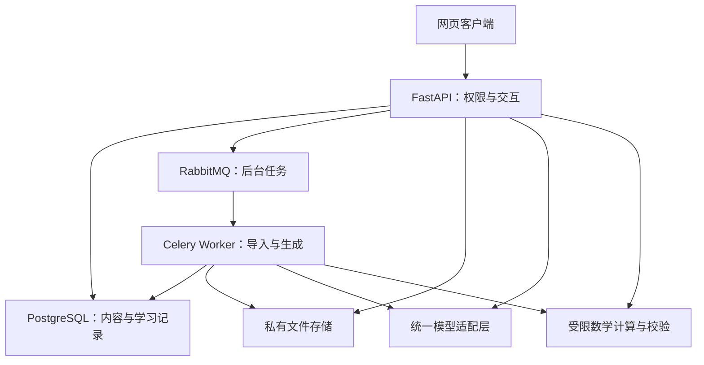

# 数学交互学习工作台

面向大学数学系本科生的 AI 数学学习项目。结合教材原文、交互图像、经典定理与正反例，帮助学生形成直觉、发现证明思路，并通过 AI 生成的针对性练习和完整解答掌握严谨论证。

> 项目工作名：Axiom 公理。已提供可运行的前端演示；本文仍作为完整产品需求与架构说明，不表示所有能力已经实现。
>
> **2026-11-15 Word 讲义版**：主输入改为 `.docx`，原讲义按章节/段落连续显示；自动识别数学词语并在原文字词上生成图像链接，点击进入对应图像，返回原段落。产品内提供“AI 规则与示例”，可保存规则版本、纠正示例并测试识别；PDF 阅读器保留为旧记录兼容入口。
>
> **2026-11-15 原讲义阅读改版**：教材学习以用户自己的 PDF 原讲义为主体，保留原文页码、缩放和阅读位置；正反例、连续/导数/Taylor/积分图像通过原文旁的**文字链接**进入独立图像页，再返回原页。用户未选择文件时显示“打开讲义”，项目测试讲义明确标注为演示文件。正反例实验室、证明思路、完整解答与复盘、前置知识诊断仍无独立入口。
>
> 文档版本：0.2 · 需求日期：2026-10-29 · 前端实现状态更新：2026-11-02
>
> **MVP：数学分析中从连续性到定积分的章节。标准正式版：覆盖本科数学分析完整主干，随后扩展到其他数学系核心课程。**

## 下载一键部署包

Windows x64 免安装完整版（含 Python 运行时、前端、后端和演示讲义）：

- [GitHub Releases 最新版](https://github.com/Relestic/axiom-math-workbench/releases/latest)
- [直接下载 v0.5.0 ZIP](https://github.com/Relestic/axiom-math-workbench/releases/latest/download/Axiom-Windows-Full-v0.5.0.zip)
- [SHA-256 校验文件](https://github.com/Relestic/axiom-math-workbench/releases/latest/download/SHA256SUMS-v0.5.0.txt)

```text
Axiom-Windows-Full-v0.5.0.zip
大小：45,529,039 字节
SHA-256：420DDB7152BF1CAFF42EE7B91878D99F5C77643841106269321255DB15F31734
```

解压后双击 `启动 Axiom.cmd`，默认打开 `http://127.0.0.1:5186/`。演示账号：`demo@axiom.local` / `axiom-demo-2026`。分享包不包含开发者密钥、真实用户数据库或私人讲义。

## 当前实现状态（2026-11-07）

已按照 8 张原型图实现 React + TypeScript 前端，并在 2026-11-15 改为 Word 讲义阅读器：DOCX 结构化正文、公式/表格/图片提示、原文字词自动图像链接、独立图像页与返回原段落、规则/示例设置、阅读问答；旧 PDF 阅读器保留兼容。工作台、练习、练习热力图、知识地图、三维曲面和笔记保留。

- **业务模块**：六个业务模块的负责范围、对外接口、数据归属和验收标准见 [MODULES.md](MODULES.md)；可视化工作区已拆为 `frontend/src/modules/visualization/`（组件、二维/三维、场景校验、hooks、API），其余模块按文档顺序逐步迁移。
- **练习批改**：计算题从作答中提取最终表达式，使用 SymPy 做符号等价检查；证明题按 ε、δ、条件、估计、结论等关键步骤输出 0–100 结构分、逐项覆盖/缺失和参考结果。结构分明确标注“不判断证明是否数学正确”，避免把关键词匹配冒充人工评阅。
- **稳定本地预览**：双击根目录 `启动本地预览.cmd`，在 <http://127.0.0.1:8080/> 同时运行前端与后端，不依赖隧道、公网或系统代理；`停止本地预览.cmd` 只停止该服务。详见 [LOCAL_PREVIEW.md](LOCAL_PREVIEW.md)。

- **后端（新增）**：`backend/` 提供可运行的单机演示后端，覆盖邀请账号与权限、教材导入与发布、定义/条件/证明/经典案例、知识图谱、图像场景与数学校验、练习与完整解答、作答记录与反馈、练习热力图、诊断、笔记、内容纠错、后台任务与模型用量。110 项 pytest 通过；启动、接口清单与验证边界见 [后端说明](backend/README.md) 与 [验证记录](backend/docs/verification.md)。
- **运行入口**：稳定本地预览双击 `启动本地预览.cmd`（`http://127.0.0.1:8080/`）；完整前后端演示双击 `启动完整演示.cmd`；也可进入 `frontend` 后运行 `npm ci`、`npm run dev`。后端在 `backend` 下运行 `python -m app.cli seed --demo` 与 `python run.py`，API 文档为 <http://127.0.0.1:8000/api/docs>。
- **文件分享**：`releases/` 中提供 Windows x64 免安装 ZIP，解压后双击包内的 `启动 Axiom.cmd`；随包提供运行环境，AI 需接收者自行配置密钥。该 ZIP 是 2026-11-02 的前端独立包，不含本次后端联调；联调版请使用 `启动完整演示.cmd`，待正式发布前再重新打包。
- **前端说明**：[功能、运行与实现边界](frontend/README.md)；[数据层与迭代指南](frontend/docs/architecture.md)；[验证记录](frontend/docs/verification.md)。
- **在线预览与部署**：临时公网地址、演示账号与隧道重启方式见 [ONLINE_PREVIEW.md](ONLINE_PREVIEW.md)。该地址依赖开发机，不是正式上线；真正部署使用 [`Dockerfile`](Dockerfile)、[`docker-compose.yml`](docker-compose.yml) 和 [部署说明](deploy/README.md)（腾讯云 Lighthouse/CVM、VPS、Render/Railway/Fly.io）。
- **自由函数与 AI 改图**：新增 Math.js 表达式引擎、Plotly 交互绘图和本地 Node API。支持通过可配置的 OpenAI 兼容接口生成函数、参数、比较曲线与分析配置，经过校验后应用；未填写模型配置时可直接编辑公式。配置方法见 [AI 改图说明](frontend/docs/ai-functions.md)。
- **三维曲面实验室**：新增 `z=f(x,y)` 的可交互三维曲面，支持拖动旋转、滚轮缩放、范围/网格/高度/透明度/配色控制，并可通过 DeepSeek 对话修改曲面与视角；场景经后端 `SurfaceScene` 与表达式白名单校验。
- **DeepSeek API**：支持 `AXIOM_AI_PROVIDER=deepseek`，默认 `https://api.deepseek.com` / `deepseek-chat`；在线预览已配置并实测 `/api/v1/ai/test` 与 `/api/ai/plot`。`deepseek-reasoner` 会自动跳过不支持的 `temperature` / `response_format`；未配置密钥时明确显示未连接，不伪造 AI 回答。
- **用户自助接入 DeepSeek**：登录后在教材学习/三维曲面面板粘贴自己的 `sk-...`，选择模型并保存即可使用，无需改 `.env` 或重启；Key 使用 Fernet 加密存入 `user_ai_credentials`，接口只返回末四位，支持测试连接和移除回退系统默认。
- **范围**：8 个代表性学习单元和 32 道参数变式；前后端已完成联调，登录、内容卡片、练习、作答、笔记、收藏、诊断、图谱与热力矩阵默认读取/写入后端。自由函数场景仍保存在浏览器，正反例曲线与性质矩阵仍是前端教学示意；AI 出题的真实模型联调与完整教材解析仍待完成。AI 改图已通过本地模拟服务验证，真实模型仍需用户配置后联调。
- **完整 MVP 验收**：仍按本文以下范围与标准执行。后端演示不代替全部章节内容建设、数学审核、正式权限与试用验收。

## 1. 产品定位

### 1.1 目标用户

- 首批用户为正在学习数学分析的数学系本科生，首轮邀请 3—9 名课程进度相近的学生。
- 典型困难包括：理解定义但不会使用；看懂证明却不知道关键构造从何而来；混淆命题与逆命题；不知道定理条件为何必要；无法把图像直觉写成严格证明。
- 首版以电脑网页为主要学习环境，手机提供可完成核心任务的适配界面。PWA 和安卓安装包在后续阶段加入。

### 1.2 核心价值

1. **从图像进入证明**：将观察对应到量词、估计、不等式、辅助函数、数列构造和分割方法。
2. **用正反例理解条件**：明确一个例子满足哪些性质，以及它支持或反驳的准确命题。
3. **用教材约束 AI**：保留定义、符号、定理条件及出处，按当前课程进度选择证明工具。
4. **通过练习完成迁移**：AI 根据章节知识点生成练习，每道题提供完整解答，并解释关键思路。
5. **建立可追溯的知识联系**：连接教材、经典案例、证明依赖和练习，帮助学生定位缺失的前置知识。

核心学习过程：

**导入 .docx → 阅读原文 → 自动识别数学词语 → 点击原文字词 → 探索/与 AI 讨论 → 返回原段落 → 做本节练习。**

图像用于形成和检验直觉。最终结论通过定义、定理及完整论证建立；有限采样、动画或符号计算结果不自动构成证明。

## 2. MVP 与标准正式版的范围

### 2.1 MVP：连续性至定积分

选定一本数学分析教材作为内容主线，按知识主题组织，再映射到该书的具体章节。不同教材章节编号和顺序可以不同，但 MVP 必须覆盖下表全部模块，不能仅凭完成连续性或导数演示就认定交付完成。

| 模块 | 核心内容 | 图像与证明的连接 | 代表性练习 |
| --- | --- | --- | --- |
| 连续性 | 点与区间上的连续、单侧连续、间断点、连续运算 | 邻域、函数值变化、极限与点值的区别 | 用定义证明连续；判断并构造间断例子 |
| 闭区间上连续函数的性质 | 有界性、最值、介值性、一致连续性及相应定理条件 | 闭区间与开区间对比；固定误差下的统一控制 | 删除条件后构造反例；证明一致连续性 |
| 导数与微分 | 导数定义、单侧导数、可导与连续、求导规则、高阶导数、局部线性近似 | 左右差商、割线趋近切线、线性近似误差 | 由定义计算导数；构造连续不可导与导数不连续的例子 |
| 中值定理及应用 | Fermat、Rolle、Lagrange、Cauchy 中值定理；Darboux 定理；单调性、极值、凸性与常用极限方法 | 割线与切线、辅助函数、端点及内部条件 | 构造辅助函数；证明不等式；检查定理能否使用 |
| Taylor 公式 | 有限阶展开、选定教材采用的余项形式及条件、局部误差估计 | 多项式逼近与误差随阶数、位置变化 | 写出适用条件；估计余项；判断近似的有效范围 |
| 原函数与不定积分基础 | 原函数、不定积分、基本积分方法、换元与分部积分 | 函数与原函数的联系、原函数之间的常数差 | 验证原函数；完成支撑后续定积分的计算与推导 |
| 定积分的定义与可积性 | 有限闭区间上有界函数的 Riemann 积分；分割、标记点、Riemann 和、Darboux 上下和及可积判据 | 网格宽度、标记点选择、上下和差距 | 用定义或上下和判据证明可积、不可积 |
| 定积分性质与微积分基本定理 | 线性、区间可加性、保序与估计、积分中值定理、变上限积分、基本定理、Newton–Leibniz 公式、基础应用 | 有向面积与累积量；局部增量与函数值 | 证明积分不等式；核对基本定理条件；解释导数与积分的联系 |

范围解释：

- 实数完备性、上确界、数列与函数极限、基本逻辑与量词作为**前置知识卡片**提供，并记录哪些结论允许直接引用；MVP 不要求把这些内容建设成完整独立课程。
- 不定积分以支持证明和定积分学习所需的基础内容为准，不以覆盖全部积分技巧题为目标。
- Taylor 公式在 MVP 中指有限阶公式及余项；无穷 Taylor 级数及其收敛属于标准正式版。
- 定积分以有限闭区间上的 Riemann 积分为边界。反常积分、多元积分、Lebesgue 积分理论不纳入 MVP 必修训练。
- 扩展案例可以显示索引和直觉介绍，但必须标明超出当前进度的前置知识，不默认用于本阶段出题与解答。

### 2.2 标准正式版 V1

标准正式版必须超出 MVP 的章节范围，形成按选定本科数学分析课程大纲逐项验收的完整主干。至少包括：

| 课程范围 | 相对于 MVP 的增量 |
| --- | --- |
| 实数、数列与函数极限 | 将前置卡片扩展为完整的定义、证明、经典案例和练习单元 |
| 一元微积分 | 完善 MVP 各章的内容深度、证明方法、综合练习与教材覆盖 |
| 反常积分与数项级数 | 收敛判别、绝对与条件收敛、边界与反例 |
| 函数列与函数项级数 | 逐点与一致收敛、极限交换条件、幂级数及课程要求的 Fourier 级数基础 |
| 多元函数微分学 | 多元极限与连续、偏导与全微分、隐函数与反函数、极值问题 |
| 多元积分与参数积分 | 重积分、曲线与曲面积分、相关积分公式、含参变量积分及极限交换条件 |

V1 同时扩展多教材映射、学生自助导入、跨章节证明依赖、综合练习和更完整的内容审核流程。每个新增模块都需要补齐知识、图例、正反例、证明和练习，不能仅以新增目录或链接视为支持。

在 V1 之后，逐步扩展高等代数、解析几何、概率论、常微分方程，以及实分析等数学系课程。每门课程独立制定内容范围和验收标准；中学课程、学校班级管理及考试服务另行评估。

## 3. MVP 功能优先级

| 优先级 | 功能 | MVP 要求 |
| --- | --- | --- |
| P0 | 教材内容包 | 一部主教材的目标章节，支持管理员上传电子 PDF、章节选择、人工修订与发布 |
| P0 | 知识与证明卡片 | 保存精确定义、命题条件、证明思路、完整证明及原文定位 |
| P0 | 交互图像 | 自由输入或通过对话生成受支持的函数表达式，支持参数滑块、多曲线比较和通用分析工具；经典模板提供教学入口 |
| P0 | 经典索引与正反例 | 每个已发布知识点具有索引入口，关联经过核查的经典案例、定理或标准例子 |
| P0 | AI 练习与完整解答 | 按章节、知识点、题型、难度和已学范围生成；每题均有完整解答 |
| P0 | 作答与复盘 | 保存学生作答、提示使用情况和解答查看记录；提供针对证明步骤的反馈 |
| P0 | 局部知识图谱 | 搜索与展开证明依赖、例子、反例及关联定理；支持返回教材 |
| P0 | 对话控制 | 定位知识、切换案例、控制图像、生成练习、打开提示或解答、撤销可逆操作 |
| P0 | 账号与保存恢复 | 邀请账号，学生与管理员角色，独立学习记录与服务端权限检查 |
| P0 | 内容纠错与反馈 | 上报错题、证明疑点、图像问题与错误出处；管理员修订并保留版本 |
| P0 | 任务与用量记录 | 导入和生成的进度、失败、有限重试、费用与耗时可追踪 |
| P1 | 自助教材导入 | 向学生开放在支持范围内的电子 PDF 上传、质量检查和章节处理 |
| P1 | 更广的主题导航 | 接入获准使用的全局路线图，完善跨教材对齐和主题切换 |
| P1 | 学习计划与安装体验 | 按学习证据推荐复习，提供 PWA；安卓安装包后续评估 |

MVP 使用已授权的统一试用教材。完整的任意教材自动解析不作为首轮学习价值验证的前置条件，但管理员导入流程需要保存来源、处理状态和纠错记录。

MVP 不包括：通用扫描件及手写识别、任意命题自动形式化证明、任意数学内容自动动画生成、执行用户或模型生成的代码、多人实时编辑、学校教务管理、付费订阅及完全离线 AI。

## 4. 知识点与学习工作区

### 4.1 知识点的标准内容

每个正式发布的知识点至少包含以下栏目。栏目可以引用共享内容，避免重复维护。

| 栏目 | 内容 |
| --- | --- |
| 教材与目标 | 所属章节、学习目标、前置知识、教材页码与原文区域 |
| 定义与命题 | 符号、量词、定义域、假设、结论及适用语境 |
| 图像直觉 | 可探索的问题、对应图像或构造、显示范围与近似方式 |
| 正例与反例 | 对象定义、满足的性质、反驳的准确命题及验证方法 |
| 经典索引 | 经典定理、数学对象、图例、可靠出处与必要的历史说明 |
| 证明 | 思路说明、完整论证、关键构造、每个关键条件的使用位置 |
| 练习 | 题型、难度、允许引用的知识、提示、完整解答与常见错误 |
| 学习证据 | 学生作答、解释、纠错与迁移表现；点击或看完解答不等于掌握 |

知识点不一定适合动态图像。可以使用静态示意、量词对照、证明结构或反例构造代替，并说明该表达方式如何帮助理解。

### 4.2 核心使用流程

1. 登录并选择教材、章节和已学范围。
2. 从教材段落、具体问题、搜索或局部图谱进入知识点。
3. 阅读定义与条件，提出预测或疑问。
4. 操作图像，观察参数、区间或条件变化；按需打开经典案例。
5. 将观察连接到证明步骤，查看关键构造与完整证明。
6. 请求 AI 生成当前知识点或章节的练习，提交文字或公式作答。
7. 按需查看提示、证明思路和完整解答；系统指出可定位的推理缺口。
8. 完成一道变式或迁移题，保存学习记录并返回教材。

电脑端以“当前内容与演示”为主要区域，教材、图谱和对话可按需展开。手机端通过内容、演示、教材、练习和对话切换工作区。默认展示当前概念及有限邻域，避免全局图谱遮蔽当前学习任务。

## 5. 经典图例、定理与正反例索引

### 5.1 索引原则

每个知识点都有索引入口，优先关联历史上有代表性的数学对象、图像、定理和反例。索引的作用是解释概念与结论的边界，不能仅提供人名、图片和外部链接。

没有直接对应的著名图例时，关联相关经典定理或经过核查的标准例子，并说明关联理由。没有可靠依据的内容保持待补充，不为满足数量要求编造案例或历史。知识点正式发布前至少具有一项有效关联；不同知识点可以共享同一条经典索引。

### 5.2 索引条目

- 名称、中英文别名、对象类型、精确定义或完整定理陈述。
- 关联知识点、前置知识、MVP 核心／选学／正式版扩展标记。
- 正例所展示的性质，或反例所反驳的准确命题与条件。
- 图像、构造过程、交互模板及显示限制。
- 证明入口、关键思路、教材或讲义的章节与页码。
- 来源、访问日期、内容审核状态；涉及历史归属和年代时单独记录依据。
- 图像来源类型：历史原图、教材图、项目重绘或交互重建；保存作者、来源及使用许可信息。

“定理成立的例子”和“定理的证明”分别保存；反例必须对应命题，不能笼统标为“某定理的反例”。对于已证定理，反例通常针对其逆命题或删除假设后的错误推广。

### 5.3 首批案例候选

| 知识点 | 案例或定理 | 学习用途 | MVP 地位 |
| --- | --- | --- | --- |
| 连续与可导 | 绝对值函数在原点的左右差商 | 反驳“连续必可导” | 核心 |
| 闭区间条件 | 开区间上的简单函数、闭区间连续函数的最值与介值定理 | 区分有界、取得最值和介值等不同结论，逐项检查假设 | 核心 |
| 一致连续 | 平方函数在有界闭区间与整个实数轴上的对比、Heine–Cantor 定理 | 理解位置无关的控制与定义域的作用 | 核心 |
| 导数与连续性 | 零点补定义为 0 的 x²sin(1/x)，以及 Darboux 定理 | 可导函数的导数可以不连续，但仍有介值性 | 核心 |
| 中值定理 | Rolle、Lagrange、Cauchy 定理的几何关系与辅助函数 | 从割线方向发现构造，定位条件在证明中的作用 | 核心 |
| Taylor 公式 | 指数、三角函数的有限阶近似及余项 | 把视觉上的接近转化为有条件的误差估计 | 核心 |
| 可积性 | 阶跃函数与 Dirichlet 函数 | 前者说明有间断也可能可积；后者说明有界不保证 Riemann 可积 | 核心 |
| 可积性与间断 | Thomae 函数 | 理解具有稠密间断点的函数仍可能 Riemann 可积 | 选学，证明按前置知识开放 |
| 微积分基本定理 | 连续函数的变上限积分与 Newton–Leibniz 公式 | 区分累积函数的求导与利用原函数计算积分 | 核心 |
| 连续与可导的进一步边界 | Weierstrass 函数 | 展示处处连续、处处不可导的经典现象 | 拓展索引；完整证明不作为 MVP 必修 |

以上为内容建设候选，不代表图像、证明和历史资料已经录入或审核。微分与导数性质可参考 [John K. Hunter 的微分学讲义](https://www.math.ucdavis.edu/~hunter/intro_analysis_pdf/ch8.pdf)；Dirichlet、Thomae 与 Riemann 可积性的关系可参考其[积分讲义](https://www.math.ucdavis.edu/~hunter/intro_analysis_pdf/ch11.pdf)；Weierstrass 案例可参考其[函数列与级数讲义](https://www.math.ucdavis.edu/~hunter/intro_analysis_pdf/ch9.pdf)。

### 5.4 图像的表达要求

- 对振荡、尖点、间断等现象采用经过验证的绘制方式，不能跨间断点错误连线。
- Dirichlet 函数不能依赖浮点数“判断有理性”后普通采样绘图；使用分层示意及有理数、无理数稠密性的说明，并展示上下和的逻辑依据。
- Thomae 函数的有限分母展示、Weierstrass 函数的有限项展示明确标记为近似或构造阶段，不声称绘出了全部数学对象。
- Riemann 和展示分割与标记点选择，不能将某一种固定采样方案的数值收敛直接当作可积性证明。
- Darboux 上下和中的上确界、下确界只在支持的对象上通过已验证方法或确切界计算；采样最大最小值不得冒充精确上下和。

## 6. AI 练习、完整解答与作答反馈

### 6.1 生成依据

AI 根据已完成或指定章节的知识点、教材表述、已学范围、允许引用的定理、目标能力与难度生成课后练习。可结合学生错误生成变式，但不根据少量行为推断学生永久性的能力标签。

MVP 优先从经过审核的题型、案例和证明结构生成有约束的变式。原教材题、改编题和 AI 新生成题明确区分；生成题不能伪装为教材原题。

### 6.2 支持的题型

| 类型 | 目标 |
| --- | --- |
| 定义与量词 | 写出定义及其否定，辨析必要、充分与等价条件 |
| 判断与正反例 | 判断命题，给出证明或满足全部要求的反例 |
| 证明补全与独立证明 | 训练估计、辅助函数、数列构造、分割和条件检查 |
| 条件变式 | 改变定义域、连续性、可导性或其他假设，重新判断结论 |
| 计算与论证结合 | 完成求导、积分或近似计算，并说明适用条件和误差 |
| 跨知识点迁移 | 在允许的知识范围内结合连续、微分和积分完成综合论证 |

### 6.3 每题的交付要求

每道正式交付的练习都必须包含：

1. 无歧义的题干、定义域、参数范围、条件和所求结论。
2. 对应知识点、目标能力、难度与允许使用的前置结论。
3. 可逐步查看的提示与证明思路。
4. **完整解答**：结论、逐步论证、关键构造动机、引用定理及条件核对、必要的边界或分类讨论。
5. 常见错误、对应的概念解释与复习入口。
6. 可复现的题目版本、生成配置、模型与提示词版本，以及审核记录。

提示、思路与完整解答分别提供入口，学生可以直接查看完整解答，不设置强制答题解锁。作答记录区分独立作答、使用提示和查看解答后的作答，便于理解学习证据。

### 6.4 生成与质量控制

生成流程：选定知识与题型 → 同时生成题目、提示和解答 → 检查条件与引用范围 → 数学与结构校验 → 保存版本 → 交付。

- 检查题设是否充分、结论是否成立、证明是否循环、反例是否满足所有要求，以及是否偷用了未学结论。
- 计算题可使用符号或数值工具辅助检查；一般证明需要核对推理结构，工具结果不能替代证明审核。
- 模型复核、计算检查、模板约束和人工审核分别记录，不能把模型自检标记为人工审核或形式化验证。
- 人工核对种子题和变式规则；上线前按题型及边界参数抽查生成结果。即时生成内容显示实际校验状态，并允许上报问题。
- 未通过校验、缺少完整解答或依赖超出课程范围的题目不作为正式练习交付；有限次重试后回退到已审核题库或明确提示生成失败。
- 发现错误后可撤回题目版本，保留历史作答并提示解答已修订，避免静默改变学生当时看到的内容。

### 6.5 作答反馈

MVP 支持文字与公式作答。反馈应定位到可解释的推理缺口，例如量词错误、缺少条件、估计不成立或结论没有覆盖全部情形，并链接对应知识点。

参考解答只是一种可行论证，不能仅因学生的方法不同就判错。无法确定的证明标为“需要进一步核查”，保留原始作答和反馈依据。看过完整解答不自动计为掌握，应通过新例子或延迟复习补充证据。

## 7. 代表性学习任务

### 7.1 从一致连续的图像进入反例构造

学生提出“为什么平方函数在有界闭区间上一致连续，在整个实数轴上却不成立”。

系统展示同一个函数在两类定义域上的行为，固定纵向误差，引导学生观察横向允许距离。随后连接到一致连续定义中的量词顺序，并解释如何选择两列距离趋于零而函数值差不趋于零的点。最后生成改变区间或函数后的练习，提供完整证明及其构造动机。

### 7.2 从几何关系发现中值定理的辅助函数

学生观察曲线上两点连成的割线，系统允许移动端点并比较切线方向。证明面板同步说明为什么减去相应的线性函数能制造相同的端点值，如何检查 Rolle 定理的条件。练习要求学生在新情境下自行选择辅助函数，并逐项说明引用依据。

### 7.3 从上下和进入可积性证明

学生对比连续函数、阶跃函数和 Dirichlet 函数，调整分割并观察上下和。系统解释为什么细化分割对不同对象产生不同效果，并指出数值采样的局限。随后生成一个关于分段函数可积性的证明题，要求使用分割或允许引用的定理，并给出完整解答。

## 8. 知识图谱与教材映射

### 8.1 图谱组织

分别保存全局数学主题、教材局部知识点、经典案例、具体命题、证明与练习，通过有依据的关系连接。MVP 优先建设当前课程的局部图谱和必要主题节点；全局图谱用于定位和扩展，不要求首轮完成整个数学体系的导入。

图谱主要回答：当前概念依赖什么；证明用了哪个结论；例子说明了什么；反例反驳哪个命题；改变条件后会发生什么。

### 8.2 关系约定

| 关系 | 含义与约束 |
| --- | --- |
| `belongs_to` | 归属于主题或章节，不表示概念等价 |
| `equivalent_to` | 在明确语境及条件下等价，需要核对定义与适用范围 |
| `prerequisite_for` | 教学前置关系；检查当前学习路径中的循环依赖 |
| `uses_in_proof` | 某个证明步骤引用的定义、引理或定理，保留条件与步骤位置 |
| `implies` | 带有明确方向与条件的逻辑蕴含 |
| `example_of` | 对象具有某性质，不能由单个例子推出一般命题 |
| `counterexample_to` | 对象反驳一条明确陈述的命题，记录满足假设而结论失败的依据 |
| `illustrates` | 图像或构造帮助理解某概念或证明步骤，不代表证明成立 |
| `contrasts_with` | 比较概念、条件、性质或结论的差异 |
| `generalizes` | 明确指出推广了什么对象、条件或结论 |
| `exercises` | 练习训练的知识点及目标能力 |

关系保存来源、适用条件、证据、内容版本和审核状态。教材出处、外部资料、AI 建议与人工审核分别记录。优先提供有教学价值的关联，不按数量强制生成节点和边。

### 8.3 教材对齐与全局路线

同一概念可以对应多个教材出处；不同教材的符号、定理版本和证明路径分别保存。匹配结果区分“同一概念”“属于同一主题”“不确定”，不能通过名称相似直接合并。

[mathematics-roadmap](https://github.com/TalalAlrawajfeh/mathematics-roadmap) 保留为全局主题与路线参考。正式复用前确认许可，固定提交版本，区分主题、书籍与布局元素，再导入稳定 ID、原始标签及来源。原图连线经过语义核查后映射，不能直接视为数学蕴含或适合所有教材的学习顺序。

许可未确认时使用自行整理的课程主题结构，不复制上游内容。上游更新经过差异检查，不能覆盖已经审核的教材映射或用户记录。

## 9. 自由函数、教学工具与 AI 对话操作

### 9.1 函数表达式与教学工具

用户可直接输入函数，也可通过 AI 对话更换函数类型、组合表达式、构造分段函数、添加参数和比较曲线。AI 输出结构化场景，表达式解析器与场景校验器检查通过后，浏览器重新计算和绘图。函数表达式与分析工具分开：切换连续性、导数、Taylor 或积分工具时保留用户函数。

首阶段支持实值一元显函数，包括多项式、三角、指数、对数、绝对值及其组合与条件表达式；最多 4 条比较曲线和 8 个参数。隐函数、微分方程与自由三维曲面另行扩展。经典预设保留为教学示例，不限定用户只能选择这些函数。

每个教学工具保存版本、支持对象、参数范围、边界行为、显示精度、教学目标及对应证明步骤。

MVP 预计建设 8—10 类可复用模板，实际数量按覆盖情况确定：

| 模板族 | 主要用途 |
| --- | --- |
| 函数、邻域与间断 | 连续定义、点值与极限、分段函数 |
| 统一误差控制 | 连续与一致连续、量词与定义域 |
| 左右差商与局部线性近似 | 可导性、切线与近似误差 |
| 割线、切线与辅助函数 | 中值定理及其证明构造 |
| Taylor 多项式与余项 | 有限阶逼近和可证明的误差界 |
| 分割、标记点与 Riemann 和 | 积分定义、不同取点和网格宽度 |
| Darboux 上下和 | 可积性、分割细化与反例 |
| 变上限积分与累积量 | 微积分基本定理、有向面积与导数 |
| 经典对象的专用构造 | 支持范围内的稠密点示意、振荡或有限项近似 |

每个演示至少有一个明确的问题或预测任务，并能链接相应的证明解释。对不支持的对象返回适用范围说明和替代内容，不强行生成错误图像。

用户函数通过受限数学表达式解析器处理；禁止直接执行用户或模型提供的 JavaScript/Python 字符串。修改前检查定义域、奇点、边界与参数类型。差商中的步长不直接取零，极限状态单独表达。

拖动、滑块和动画在浏览器本地响应；模型只处理导航、解释和结构化配置，避免每次交互都发起调用。

### 9.2 对话工具

| 操作 | 作用 |
| --- | --- |
| `search_concepts` / `focus_concept` | 搜索并定位当前用户有权访问的知识 |
| `expand_relations` | 展开有限数量、指定类型的关系 |
| `open_source` | 打开教材或参考资料的页码与原文位置 |
| `open_classic_case` | 打开经典案例、精确性质、出处和证明入口 |
| `open_visualization` / `update_visualization` | 校验并更新函数表达式、定义域、参数、比较曲线与分析工具 |
| `open_proof_step` | 对照图像查看证明步骤与引用依据 |
| `generate_exercises` | 按知识范围、目标、题型及难度生成题目与完整解答 |
| `submit_attempt` | 保存学生实际提交的作答并请求反馈 |
| `show_hint` / `show_solution` | 展示提示或完整解答，记录实际查看行为 |
| `undo_action` | 撤销可逆的界面或参数修改，不伪造或删除既有作答历史 |

模型上下文包含教材版本、知识点、已学范围、当前演示、题目版本及状态版本。执行过程为：理解请求 → 生成结构化操作 → 校验权限、参数和状态 → 执行 → 返回真实结果 → 保存记录。

有歧义时提供候选或询问；失败时说明实际原因。过期状态不能覆盖用户刚完成的操作，对话不能声称执行了未成功完成的动作。

## 10. 技术架构与数据模型

### 10.1 架构

当前演示采用 React + TypeScript + Vite、Math.js、Plotly.js、Zod，以及 Vite 中注册的本地 Node API。服务端读取模型配置，调用兼容 Chat Completions 的服务商；密钥不进入前端包。运行方式与已实现边界以 `frontend/README.md` 为准。

本轮新增的独立后端演示位于 `backend/`。评审环境完全离线，没有 FastAPI、uvicorn、Celery、Alembic 或 pdfplumber，因此后端使用本机已有的 Flask 3 + Pydantic 2 + SQLAlchemy 2 + PyJWT + SymPy 实现同样的模块化单体边界：`backend/app/api/` 为入口，`modules/` 为业务，`adapters/` 隔离模型、数学、文件与 PDF，`models/` 保存 37 张表；数据库默认 SQLite，任务使用持久化 `jobs` 表与单进程 Worker，迁移使用自带的顺序迁移器。它是**候选技术栈的受限替代实现**，不是 FastAPI/PostgreSQL/Celery 部署验证。接口与验证边界见 [后端说明](backend/README.md)。

完整产品后端候选方案为模块化单体：API 与后台 Worker 共享一套业务代码。API 处理交互，Worker 处理教材导入、批量内容生成和耗时校验。MVP 可单机部署，按实际负载分别扩充进程。下图为后续完整产品规划，当前未部署这些服务。



| 层次 | 候选方案 | 职责 |
| --- | --- | --- |
| 前端 | React + TypeScript + Vite | 学习工作区、练习、对话与状态管理 |
| 图谱 | Cytoscape.js | 节点、关系、检索与局部展开 |
| 数学演示 | Math.js + Plotly.js；专用构造视需求扩展 | 表达式解析、曲线、滑块、多函数比较与教学构造 |
| 数学排版与教材阅读 | MathJax + PDF.js | 公式显示、跳页与原文区域定位 |
| 文档解析 | pdfplumber + 可替换的视觉模型接口 | 提取文本、坐标和异常区域，供人工复核 |
| 服务端 | FastAPI + Pydantic | API、权限、结构化输入输出与业务模块 |
| 数学辅助检查 | SymPy + 数值计算 | 支持范围内的计算检查与边界验证 |
| 数据持久化 | PostgreSQL + SQLAlchemy + Alembic | 业务数据、查询与数据库迁移 |
| 后台任务 | Celery + RabbitMQ | 排队、重试、阶段状态与任务执行 |
| AI 接入 | 官方 SDK + 内部适配层 | 结构化生成、工具调用、超时与用量记录 |
| 部署 | Docker Compose + HTTPS 反向代理 | 开发环境与单机邀请试用 |

以上为候选技术方案，不代表已完成依赖兼容性、性能或部署验证。工程阶段选择受支持的组合并写入锁文件；本文不把尚未核验的补丁版本作为保证。解析器、模型和存储通过内部接口接入，便于替换。

### 10.2 逻辑数据模型

| 实体 | 核心内容 |
| --- | --- |
| 用户与授权 | 用户、角色、资源访问范围 |
| 教材与来源片段 | 文件、版本、所有者、章节、PDF 页索引、印刷页码、文本与区域坐标 |
| 主题与知识点 | 稳定 ID、名称与别名、定义、条件、符号、课程范围和教材映射 |
| 命题与证明 | 精确陈述、假设、结论、证明步骤、引用依赖及审核状态 |
| 经典案例与图例 | 对象定义、性质、目标命题、来源、历史说明、图像类型与使用许可 |
| 图谱关系 | 起终点、关系类型、适用条件、证据与内容版本 |
| 模板与演示状态 | 模板版本、参数规范、默认配置、个人配置与状态版本 |
| 题型与练习版本 | 生成约束、题干、目标、前置知识、提示、完整解答及校验记录 |
| 作答与反馈 | 原始作答、实际查看记录、反馈、错误类型、所用题目版本 |
| 会话与学习证据 | 上下文、操作结果、笔记、收藏、学习进度与迁移表现 |
| 任务与模型调用 | 阶段、尝试次数、输入版本、模型与提示词版本、耗时、用量和错误 |

内容、个人学习记录和个人演示状态分开保存。复用同一案例或题型不能导致用户之间共享私人作答、会话或文件。

所有私有资源由服务端检查权限；检索、缓存和后台任务同样携带资源范围。缓存标识至少区分权限范围、教材与内容版本、生成配置及必要的模型和提示词版本。

## 11. 内容处理、可靠性与运营

### 11.1 教材与内容发布

电子 PDF 上传 → 质量检查 → 确认章节 → 提取文本与公式位置 → 生成候选知识和关系 → 人工核对定义与条件 → 关联证明、经典案例与模板 → 校验练习题型 → 发布内容版本。

清晰电子 PDF 仍可能出现公式提取错误。异常公式保留原文位置并进入复核，不确定内容不直接变成已审核知识。目录、PDF 页索引与印刷页码分别维护。

发布状态与校验记录分开：内容可处于草稿、待复核、已发布或已撤回；同时记录哪些检查由程序、模型或人工完成。AI 建议不自动成为已发布课程内容。

### 11.2 任务与成本

- 导入并发初始设为 1，对话与练习生成单独限制并发，避免导入阻塞全部交互。
- 排队、处理、待复核、完成、失败及取消状态持久化，刷新和服务重启后可以查询。
- 每阶段设置超时、有限重试和幂等标识；重复执行不能产生重复知识点或练习版本。
- 记录模型调用次数、用量、耗时、重试和校验结果，分别估算每章内容处理及每道交付练习的成本。
- 限制文件大小、页数、单次出题数量、个人用量和全局预算，具体值通过样本测试确定。
- 用户取消任务后不再启动后续阶段；已发生的调用和费用仍保留记录。
- 模型或后台暂时不可用时，已发布知识、经典案例和已审核练习仍可阅读。

### 11.3 访问与维护

采用邀请账号与最少必要的个人信息；密钥仅保存在服务端，接口使用 HTTPS。共享教材需明确授权，私人文件不能因为哈希相同而自动向其他用户公开。

支持删除个人材料、学习记录和会话，并明确派生数据、日志及备份的保留周期。数据库结构变更使用迁移脚本；教材文件与数据库均备份到服务器之外，并验证恢复过程。

首轮采用人工内容审核与问题分流即可，不要求先建设复杂的协同审核系统。内容审核时间和纠错成本需要与模型费用一同记录。

## 12. 开发里程碑

所有阶段均为计划项；MVP、标准正式版和后续课程扩展分别验收。

| 阶段 | 交付内容 | 通过条件 |
| --- | --- | --- |
| M0：课程与工程基线 | 确定教材、目标章节、前置知识和内容清单；建立项目、账号隔离、数据迁移与适配接口 | 范围与内容归属明确；新环境能启动；两个账号互不越权 |
| M1：单个完整学习单元 | 优先实现一致连续或中值定理：原文、图像、案例、证明、AI 练习、完整解答与保存恢复 | 学生可独立完成一次完整学习任务，并记录学习反馈 |
| M2：覆盖全部 MVP 模块 | 完成连续性至定积分的模块、局部图谱、经典索引、模板与生成题型；补齐管理员导入和纠错 | 各模块均有可验收的学习单元，不能只完成前几章 |
| M3：MVP 邀请试用 | 3—9 名数学系学生试用，完成设备适配、恢复验证、内容与用量记录 | 核心流程可独立使用，数学错误和生成失败可追踪、可处理 |
| M4：标准正式版 V1 | 扩展至本科数学分析完整主干，多教材映射、自助导入、综合练习与更完整的内容管理 | 第 2.2 节课程范围按选定大纲逐项验收，新增模块达到相同内容质量标准 |
| M5：跨课程扩展 | 逐门增加高等代数、解析几何、概率论等课程 | 每门课程有明确内容包、适用模板、经典索引、练习及独立验证 |

M1 用于尽早验证体验，不等于完成 MVP。根据反馈可以调整实现顺序和内容深度；若变更 MVP 覆盖范围，需要明确更新本说明。

### MVP 内容建设的初始估算

以下数字用于安排首轮工作量，不构成覆盖全部教材细节的承诺：

- 约 40—60 个经过核对的核心知识单元，覆盖第 2.1 节全部模块。
- 约 15—25 个可复用的经典定理、图例或正反例条目，每个已发布知识点具有有效索引关联。
- 约 8—10 类交互模板，并保留不适合动态图像的替代表达。
- 约 20—30 个经过审核的练习题型或生成规则；每个核心知识点至少有一道完整解答的验收题，各模块均包含证明训练和条件或反例辨析。

最终数量以教材内容矩阵和质量检查为准，优先保证条件、证明和解答可靠，不以节点或题目数量代替学习价值。

## 13. MVP 验收与学习价值验证

### 13.1 内容验收

- [ ] 连续性至定积分的所有模块都有可使用的学习内容，前置知识与拓展内容有明确标记。
- [ ] 已发布知识点保留定义、关键条件、符号及可定位的来源。
- [ ] 每个知识点有有效的经典案例、定理或标准例子索引，来源与关联理由可查看。
- [ ] 正反例对应准确命题；经典对象的性质、条件与证明经过核对。
- [ ] 图像明确表达显示范围、近似或构造阶段，关键观察能够连接到证明步骤。
- [ ] 每道交付练习都有完整解答，引用知识不超出设定范围，失败时可以回退或说明原因。
- [ ] 题型及边界参数经过抽查，程序、模型与人工审核状态可区分。
- [ ] 学生的不同有效证明路径不会仅因不匹配参考解答而被判错；无法确认的反馈明确保留不确定性。

### 13.2 产品与运行验收

- [ ] 用户可完成“定位知识 → 操作图像 → 查看案例和证明 → 生成练习 → 作答 → 查看完整解答 → 恢复学习”的流程。
- [ ] 对话操作与实际界面结果一致，非法参数有明确反馈，可逆操作可撤销。
- [ ] 题目版本、原始作答、反馈及解答查看记录可恢复，内容修订不会静默改写历史。
- [ ] 私有文件、学习记录、会话和后台任务均通过权限验证。
- [ ] 任务状态在刷新和重启后保留；失败可有限重试，不产生重复业务数据。
- [ ] 多名试用者同时使用时，导入任务不会阻塞所有交互。
- [ ] 电脑与至少一台目标安卓设备上完成核心流程测试。
- [ ] 已验证数据库及教材文件的备份恢复，并记录代表性任务的耗时与费用。

### 13.3 学习价值验证

首轮关注学生是否能使用定义、检查条件、构造正反例以及完成新的证明任务。操作次数、聊天次数和停留时间仅作辅助信息。

对每个重点学习单元准备短前测、学习任务和结构相近但不重复的迁移题，记录提示与完整解答的使用情况；必要时安排延迟复习。若进行工具对比，使用难度接近的不同题目，并记录顺序影响。

评价采用人工核对的评分要点，至少关注量词与条件、关键构造、推理完整性和结论是否覆盖题目要求。3—9 人试用以任务观察、作品分析和访谈为主，不据此宣称普遍或因果性的学习效果。

内容错误、学生无法完成的步骤、审核成本及再次使用意愿共同决定后续迭代。正式版扩展前先处理已发现的关键数学错误和核心流程问题。

## 14. 部署、代码组织与启动状态

### 14.1 部署与扩展

MVP 可使用一台云主机运行反向代理、API、Worker、PostgreSQL 和 RabbitMQ。文件存储通过统一接口访问，数据库保存文件标识与权限信息；具体资源规格根据教材处理与模型调用样本实测确定。

任务排队增加时优先检查调用配额、审核积压与任务耗时，再扩充 Worker；交互瓶颈出现时扩充 API；多机需要共享文件时迁移到私有对象存储；查询变慢时先检查索引与查询方式。

语义检索可以提供候选知识与案例，不自动证明概念等价或逻辑关系成立。扩展教材和课程时保持稳定 ID 与版本迁移，保留用户历史学习记录。

### 14.2 建议代码组织

| 建议路径 | 职责 |
| --- | --- |
| `frontend/` | 学习工作区、教材、图谱、演示、练习与对话 |
| `backend/app/api/` | API、认证与权限入口 |
| `backend/app/modules/` | 教材、知识、案例、证明、练习、作答和学习记录业务 |
| `backend/app/adapters/` | 模型、文件、解析器与数学计算适配 |
| `backend/app/workers/` | 内容导入、生成、复核任务与重试 |
| `backend/migrations/` | 数据结构迁移 |
| `content/curriculum/` | 课程大纲、范围与知识覆盖矩阵 |
| `content/classics/` | 经典案例、来源、性质与展示约定 |
| `content/exercise_templates/` | 审核过的题型、约束与解答结构 |
| `tests/` | 权限、任务恢复、内容校验、数学边界与端到端流程检查 |
| `infra/` | 容器与部署配置 |
| `docs/` | 数据与接口规范、审核规则、验收和用户试用记录 |

**前端演示代码位于 `frontend/`，后端演示代码位于 `backend/`。** 一键启动可双击根目录 [`启动完整演示.cmd`](<启动完整演示.cmd>)；也可前端运行 `npm ci`、`npm run dev`，后端进入 `backend` 后运行 `python -m app.cli init`、`python -m app.cli seed --demo`、`python run.py`。前端通过 `frontend/.env` 的 `VITE_API_BASE` 指向后端，默认 `http://127.0.0.1:8000`。运行 `npm test`（21 项）、`npm run build` 检查前端，运行 `python -m pytest -q` 执行 110 项后端测试。数据层与扩展方式见 [前端架构指南](frontend/docs/architecture.md)，联调边界与验证见 [前端说明](frontend/README.md)、[前端验证](frontend/docs/verification.md) 与 [后端说明](backend/README.md)。

后端实际目录与本表规划对应：`backend/app/api/` 对应 API，`backend/app/modules/` 对应业务，`backend/app/adapters/` 对应模型/文件/解析/数学适配，`backend/app/workers/` 对应导入与生成任务，`backend/migrations/` 对应迁移，`backend/app/seed/` 与 `backend/tests/` 分别保存示例内容和测试；根目录的 `content/`、`infra/` 尚未建立。`backend/app/seed/` 中的 8 个示例单元是演示内容，不是 `content/curriculum/` 的正式课程矩阵。

环境配置预计包含数据库、队列、私有文件存储、模型供应商与模型 ID、超时、重试、导入限制、出题限制和预算。示例配置不包含真实密钥。

### 14.3 前后端启动

Windows 一键启动：双击项目根目录 `启动完整演示.cmd`，它会启动后端、等待健康检查、启动前端并打开 <http://127.0.0.1:5174/>。也可以分别执行：

后端：

```powershell
cd backend
copy .env.example .env
python -m app.cli init
python -m app.cli seed --demo
python run.py
```

前端：

```powershell
cd frontend
npm ci
npm run dev
```

后端默认地址为 <http://127.0.0.1:8000/>，接口浏览页为 <http://127.0.0.1:8000/api/docs>，**浏览器试用台**为 <http://127.0.0.1:8000/demo>。前端登录演示学生 `demo@axiom.local` / `axiom-demo-2026`，管理员 `admin@axiom.local` / `axiom-admin-2026`，演示邀请码 `AXIOM-DEMO-2026`。这些值只用于本地演示；生产启动会拒绝默认密钥与默认管理员密码。

前端登录后使用服务端内容与学习记录；未连接后端时可在登录页选择“离线演示”，继续使用静态内容与浏览器存储。自由函数场景仍保存在浏览器，AI 通过后端 `/api/ai/status` 与 `/api/ai/plot` 调用。

## 15. 待落实事项与参考资料

### 15.1 待落实事项

- 主教材的名称、作者、版本、目标章节对应关系及试用材料的使用范围。
- 首批数学系学生的课程进度、允许引用的前置结论及证明训练目标。
- 内容审核负责人、题型审核方式及首批经典索引的来源记录。
- 正式名称、视觉风格、部署地区、模型选择、费用预算和使用额度。
- 全局路线图等外部内容的复用许可，以及本项目自身的许可证。
- 文件、作答、会话与日志保留策略，以及具体依赖组合的验证结果。

上述事项通过课程样本与工程验证确定，不改变已经确定的数学系定位、MVP 章节范围及正式版扩展目标。

### 15.2 数学内容参考

- [John K. Hunter：Introduction to Analysis](https://www.math.ucdavis.edu/~hunter/intro_analysis_pdf/intro_analysis.html)：本科分析的定义、证明与例子参考；实际内容以选定主教材的陈述和课程进度为准。
- [微分学](https://www.math.ucdavis.edu/~hunter/intro_analysis_pdf/ch8.pdf)、[Riemann 积分](https://www.math.ucdavis.edu/~hunter/intro_analysis_pdf/ch11.pdf)、[积分性质与微积分基本定理](https://www.math.ucdavis.edu/~hunter/intro_analysis_pdf/ch12.pdf)：对应 MVP 的数学内容核查入口。
- [函数列与级数](https://www.math.ucdavis.edu/~hunter/intro_analysis_pdf/ch9.pdf)：正式版扩展及部分经典对象的参考。
- [mathematics-roadmap](https://github.com/TalalAlrawajfeh/mathematics-roadmap)：全局主题与路线参考，实际复用以许可确认和语义核查为前提。

这些资料提供内容核查入口，不表示已经取得教材、图像的再发布授权，也不表示全部候选内容已完成审核。历史归属、原图出处与复用条件需要在实际收录条目时分别核对。

### 15.3 技术资料

- [React](https://react.dev/) · [Vite](https://vite.dev/) · [Cytoscape.js](https://js.cytoscape.org/) · [JSXGraph](https://jsxgraph.org/docs/)
- [MathJax](https://www.mathjax.org/) · [PDF.js](https://mozilla.github.io/pdf.js/) · [pdfplumber](https://github.com/jsvine/pdfplumber)
- [FastAPI](https://fastapi.tiangolo.com/) · [Pydantic](https://docs.pydantic.dev/) · [SymPy](https://www.sympy.org/)
- [PostgreSQL](https://www.postgresql.org/) · [SQLAlchemy](https://docs.sqlalchemy.org/) · [Alembic](https://alembic.sqlalchemy.org/)
- [Celery](https://docs.celeryq.dev/) · [RabbitMQ](https://www.rabbitmq.com/docs) · [Docker Compose](https://docs.docker.com/compose/)

## 16. 本版变更

- 目标用户明确为大学数学系本科生，教学目标转向图像直觉、证明训练与正反例理解。
- MVP 范围明确为连续性至定积分；标准正式版必须扩展到本科数学分析完整主干，其他数学系课程作为后续方向。
- 新增知识点标准内容、经典索引、证明步骤与图像对应、AI 练习和完整解答、作答反馈及学习证据。
- 将用户反馈与内容纠错纳入 P0；首轮使用统一试用教材，将任意教材自动处理与完整全局图谱的投入后移。
- 更新图谱关系、数据模型、里程碑与验收标准，区分单个学习单元试验、完整 MVP 和标准正式版。

