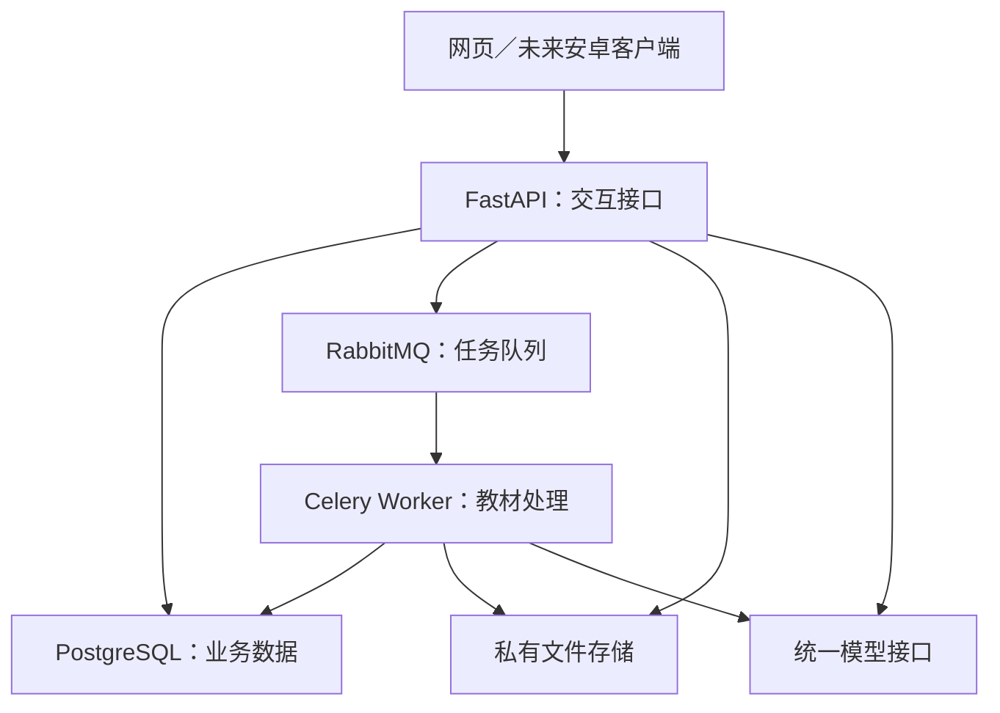

# 数学交互学习工作台

面向大学生的 AI 数学学习项目：上传清晰的电子版数学教材 PDF，将教材章节与知识点连接到全局数学路线图，通过交互演示和自然语言探索概念、查看原文、调整参数。

> 项目工作名，正式名称待定。当前处于需求与架构设计阶段，本文描述计划实现的功能，不代表已有可运行软件。技术方案尚未完成整套依赖兼容性和性能验证。
>
> 文档版本：0.1 · 更新日期：2026-10-29

## 1. 项目定位

### 目标用户与使用场景

- **目标用户**：大学本科生，首批重点服务正在学习高等数学或数学分析入门内容的学生。
- **首轮规模**：3—9 名邀请用户，验证完整学习流程和实际学习价值。
- **典型场景**：阅读教材时不理解某个概念，希望找到前置知识、查看动态解释，并通过改变条件检验理解。
- **建议试点**：选定一本教材的“函数—极限—连续—导数”相关章节，优先验收其中 1—2 章。
- **产品形式**：先提供适配电脑和手机的网页版，后续增加 PWA 和安卓安装包。

首版只针对大学生设计与验证；中学课程、教师课堂管理和其他人群作为后续独立需求评估。

### 核心价值

1. 帮助学生理解一个知识点在教材和数学体系中的位置。
2. 用有来源的关系解释“先学什么、为什么相关、可以用来做什么”。
3. 通过可操作的数学演示，观察参数和条件变化对结果的影响。
4. 将教材原文、知识图谱、数学演示和对话操作连接为连续的学习过程。

首轮验证关注：学生能否完成任务、解释概念并迁移到新例子；点击次数和聊天次数只作为辅助使用指标。

## 2. 已确定的设计与首版边界

| 项目 | 决策 |
| --- | --- |
| 全局框架 | 采用 [TalalAlrawajfeh/mathematics-roadmap](https://github.com/TalalAlrawajfeh/mathematics-roadmap) 作为主题与学习路线来源 |
| 教材输入 | 文字清晰、可提取文本的电子版 PDF；上传后进行质量检查 |
| 图谱组织 | 全局主题图谱与每本教材的局部图谱分别保存，通过映射连接 |
| 关联目标 | 每个知识点优先提供至少两个有依据、有学习价值的关联；依据不足时允许少于两个 |
| 内容可视化 | 优先使用经过验证的数学模板，由 AI 选择模板并配置参数 |
| 软件交互 | 支持点击操作，也支持主对话框定位知识、打开原文和控制演示 |
| 首版账号 | 邀请制，具备用户和管理员两类角色 |
| 扩展方式 | 保持一套后端业务代码，按需增加教材模板、API 实例、任务进程和客户端 |

“清晰电子 PDF”不等于公式一定能准确提取。异常公式保留原文位置并进入复核流程；无法可靠解析的内容应明确提示。

### Demo 功能优先级

| 优先级 | 功能 | 首版要求 |
| --- | --- | --- |
| P0 | 账号与访问控制 | 每位用户拥有独立学习记录；所有私有资源由后端验证访问权限 |
| P0 | 教材上传与处理 | 支持整本上传、按章处理，也支持选择部分章节优先处理 |
| P0 | 任务进度与恢复 | 展示排队、处理中、待复核、完成、失败状态；可重试失败步骤 |
| P0 | 知识提取 | 提取定义、定理、方法及例题，保留条件和原文出处 |
| P0 | 图谱浏览 | 搜索、点击、展开邻接节点、切换教材局部与全局主题视图 |
| P0 | 原文定位 | 从知识点跳转到 PDF 页码，并定位或标注对应区域 |
| P0 | 数学交互 | 提供约 5—8 个可复用模板，覆盖首批教材主题 |
| P0 | 对话操作 | 搜索节点、展开关联、打开演示、修改支持的参数、查看原文、撤销修改 |
| P0 | 保存与恢复 | 保存个人学习进度、会话和演示配置，重新登录后可以恢复 |
| P0 | 内容纠错 | 管理员可以修订知识点、关系及映射，记录修改版本 |
| P1 | PWA | 在支持的设备和浏览器中提供添加到桌面的能力 |
| P1 | 用户反馈 | 提供简短的问题反馈与学习体验记录入口 |
| 后续 | 更广的课程覆盖 | 根据反馈增加线性代数、概率论等内容和模板 |
| 后续 | 安卓安装包 | 使用 Capacitor 复用网页前端，并进行移动端专项适配 |

首版范围外：扫描件与手写教材的通用识别、任意数学内容的自动动画生成、用户任意代码执行、多人实时编辑、学校班级管理、付费订阅、完全离线 AI。

## 3. 核心使用流程

1. 用户通过邀请账号登录，选择或上传教材。
2. 系统检查 PDF 质量，识别章节；用户可修订目录并选择优先处理的章节。
3. 后台逐章生成教材知识点、来源定位和候选关联；已完成章节可以先行查看。
4. 系统将教材知识点归入全局主题，明确区分主题归属与概念等价。
5. 用户在图谱中点击知识点，打开定义、条件、例题、关联和原文入口。
6. 用户打开数学演示，通过拖动或对话修改函数、参数和显示方式。
7. 用户在主对话框中定位其他知识点、查看前置知识或返回教材。
8. 系统保存个人会话和演示状态，用户稍后可以继续。

**示例任务**：用户提出“我不理解连续为什么不一定可导”。系统定位相关概念，展示绝对值函数在原点的左右变化率，允许用户切换函数，并提供教材原文和解释。

电脑端采用可调整的图谱、内容与对话面板；手机端通过“地图、演示、教材、对话”切换工作区。图谱默认展示当前概念及有限邻域，按需展开。

## 4. 技术架构

采用模块化单体：一套后端代码按功能分模块，API 进程处理交互，Worker 进程处理教材导入与生成。首版可以单机部署，后续分别扩充进程和资源。



### 技术选型

| 层次 | 方案 | 职责 |
| --- | --- | --- |
| 前端 | React + TypeScript + Vite | 界面、导航、当前选中对象、聊天与应用状态 |
| 知识地图 | Cytoscape.js | 节点、边、布局、筛选、聚焦和邻域展开 |
| 数学演示 | JSXGraph | 曲线、几何对象、滑块、切线等交互 |
| 公式排版 | MathJax | 显示解释与知识卡片中的数学公式 |
| 教材阅读 | PDF.js | PDF 显示、跳页和原文区域定位 |
| 文档提取 | pdfplumber | 提取电子 PDF 的文字、坐标和版面信息 |
| 辅助识别 | 可替换的视觉模型接口 | 处理提取异常的公式或图像区域，结果需复核 |
| 后端 | FastAPI + Pydantic | API、输入输出校验、权限及业务逻辑 |
| 数学计算 | SymPy + 数值计算 | 支持范围内的符号计算和数值检查 |
| 数据库 | PostgreSQL + SQLAlchemy | 账号、教材、图谱、会话、任务与学习记录 |
| 数据迁移 | Alembic | 管理数据库结构变更，保留已有数据 |
| 后台任务 | Celery + RabbitMQ | 排队、任务执行、重试与任务分工 |
| AI 调用 | 模型供应商官方 SDK + 项目内部适配层 | 统一结构化生成、工具调用、超时和用量统计 |
| 部署 | Docker Compose + HTTPS 反向代理 | 统一开发与单机试用环境 |

**候选运行基线**：Node.js 24 LTS、Python 3.13、PostgreSQL 17、React 19 系列。其他组件选择仍受维护且经过组合测试的稳定版本。具体补丁版本在 M0 阶段核对支持状态并写入锁文件；升级需要重新运行关键验收场景。

Docling 可作为后续解析器对比选项。知识提取流程依赖统一的解析结果格式，避免业务逻辑绑定某一个解析工具。

## 5. 全局图谱与教材图谱

### mathematics-roadmap 的接入

以固定提交版本的 `mathematics-roadmap.drawio` 和主题列表为来源，编写一次性可重复执行的导入流程：

1. 解析节点 ID、标签、父子关系和连线端点。
2. 区分数学主题、课程、推荐书籍和纯布局元素。
3. 保存原始来源 ID、仓库地址、提交版本和原始标签。
4. 建立本项目使用的稳定 ID、中英文标签与别名。
5. 原路线中的连线先保留原始语义；经过核查后再映射为教学前置等关系。

Roadmap 主要提供主题与学习路线。教材中的具体定义、定理及其条件由局部图谱补充；原图中的箭头不能直接解释为数学蕴含。

上游更新作为新版本导入，经过差异检查后应用；不直接覆盖已经确认的教材映射和用户学习数据。

### 图谱关系约定

| 关系 | 含义 | 约束 |
| --- | --- | --- |
| `belongs_to` | 知识点归属于某个主题或章节 | 不能用于表示概念等价 |
| `equivalent_to` | 在明确语境下表示同一概念或等价表述 | 需要核对定义与适用范围 |
| `prerequisite_for` | 教学上建议先掌握的知识 | 检查选定学习路线中的循环依赖 |
| `implies` | 在给定条件下可以推出 | 必须保留方向与条件 |
| `applies_to` | 方法或概念的应用 | 给出使用条件和例子 |
| `contrasts_with` | 用于比较差异 | 优先提供区分点或反例 |
| `generalizes` | 对已有概念的推广 | 明确推广方式 |
| `related_to` | 已知有关但未细分的关系 | 不用于直接生成强制学习顺序 |

优先从已有关系和教材证据中筛选至少两个相关知识点。数量不足时可以显示一个或零个，提示缺少依据；不递归强制生成新节点凑数。

每条边记录来源、适用条件、证据及审核状态。来源分为教材、外部路线图和 AI 建议；“有教材出处”和“已人工审核”分别记录。AI 建议默认处于待核查状态。

### 教材知识点对齐

候选检索使用名称、别名、定义和上下文。匹配结果分为“同一概念”“属于该主题”“不确定”。不确定结果保留待核查状态，不能强行合并。

同一概念可以有多个教材出处；不同教材的符号、定义版本和前提条件分别保留。局部图谱中的修改不会自动改写全局数据。

## 6. 数据模型与隔离原则

以下为逻辑模型，具体表结构在开发阶段确定。

| 实体 | 核心字段或内容 |
| --- | --- |
| 用户与访问授权 | `user_id`、角色、资源访问授权 |
| 教材版本 | `book_id`、版本 ID、所有者、文件标识、文件哈希、处理状态 |
| 章节与原文片段 | 章节层级、PDF 页索引、印刷页码、文本、区域坐标和坐标系 |
| 全局主题 | 稳定 ID、类型、名称、别名、上游来源与版本 |
| 教材知识点 | 教材版本、概念类型、定义、条件、符号约定、出处 |
| 图谱边与映射 | 起终点、关系类型、适用范围、证据、来源、审核状态 |
| 演示模板与配置 | 模板 ID、模板版本、参数规范、默认配置 |
| 个人学习记录 | 用户、知识点、收藏、进度、个人笔记 |
| 会话与操作记录 | 用户、教材、选中概念、消息、实际操作结果、状态版本 |
| 处理任务与调用记录 | 阶段、进度、尝试次数、错误、模型与提示词版本、用量和耗时 |

必须遵守以下边界：

- 教材内容、个人学习记录、个人演示状态分别保存。
- 私有教材、聊天及演示配置的权限由后端统一检查；检索和后台任务同样携带并校验资源范围。
- 公共或共享教材必须经过明确授权；私人教材不因内容相同而自动对其他用户可见。
- 缓存标识包含资源权限范围、教材版本、处理版本及必要的模型／提示词版本。
- PDF 页索引与书上印刷页码分别记录，避免跳转错位。
- API 可恢复状态保存在持久化存储中，避免依赖单个进程的内存。
- 数据库结构变更通过迁移脚本执行；教材与文件同步备份并验证恢复。

## 7. 数学可视化与对话操作

### 模板机制

首批建议模板：函数图像、参数变换、邻域与极限、连续性与反例、割线趋近切线、局部线性近似。最终数量以选定教材的知识覆盖为准。

每个模板包含版本、参数规范、支持的数学对象、参数限制和教学说明。无法提供合适动态演示的知识点，展示定义、例题、反例或证明步骤，并说明当前支持范围。

示例配置（设计样例，接口尚未实现）：

```json
{
  "template_id": "derivative_secant",
  "template_version": "1",
  "concept_id": "example_derivative",
  "parameters": {
    "function": "x^2",
    "point": 1,
    "h": 0.5,
    "domain": [-3, 3]
  },
  "display": {
    "show_tangent": true,
    "show_slope": true
  },
  "state_version": 1
}
```

修改参数前检查支持的表达式、定义域、奇点与边界。差商模板中的 `h` 不直接取零；极限状态采用明确的展示逻辑。数值采样与符号工具只能辅助校验，不能被标记为任意命题的证明。

用户输入的函数通过受限数学表达式解析器处理；不直接执行用户或模型提供的 JavaScript/Python 字符串。滑块、拖动和动画在浏览器本地计算，避免每次交互都调用模型。

### 对话工具

| 操作 | 作用 |
| --- | --- |
| `search_concepts` | 在当前用户可访问的教材及全局主题中搜索 |
| `focus_concept` | 定位并选中知识点 |
| `expand_relations` | 按类型展开有限数量的相邻节点 |
| `open_source` | 打开原文页码和区域 |
| `open_visualization` | 加载适用模板 |
| `update_visualization` | 校验并更新指定演示配置 |
| `undo_action` | 恢复可撤销的上一个操作状态 |

主对话框可以导航整个工作区；概念对话默认作用于当前知识点。传给模型的上下文包含当前教材、概念、演示 ID、选中对象和状态版本。

处理流程：理解请求 → 生成结构化操作 → 校验权限和参数 → 执行 → 返回实际结果 → 保存状态。失败时明确反馈；有歧义时询问或提供候选。对过期状态发出的修改检查版本，避免覆盖用户刚完成的操作。

## 8. 教材处理与运行可靠性

### 导入流程

上传与质量检查 → 目录确认 → 按章解析 → 知识提取 → 概念去重与映射 → 候选关系核查 → 模板匹配 → 保存可用结果。

各阶段独立记录进度。生成内容保存来源和校验状态；已完成章节可先行浏览，待复核内容应有明确标记。

### 任务与成本控制

- Demo 的教材处理并发先设为 1，其余任务排队；对话请求单独限制并发。
- 每一阶段有超时、有限重试和持久化状态；Celery 确认与重试策略需要实际测试。
- 以任务阶段及输入版本构造幂等标识，重复执行不产生重复业务数据。
- 模型调用记录用量、延迟、失败和重试；外部请求中断可能导致重复计费，应明确重试上限。
- 仅在用户打开演示时生成必要配置，复用适用的已验证结果。
- 设置文件大小、页数、个人用量及全局费用上限；具体数值在教材样本测试后确定。
- 对取消任务、限额触发和暂时不可用给出可恢复的状态。

### 账号与数据

首版采用邀请制账号和最少必要的个人信息。密钥只保存在服务端，使用 HTTPS；登录、文件和资源访问采用成熟的认证与权限实现。支持用户删除个人教材与学习记录，并定义相关派生数据和备份的保留方式。

## 9. 开发里程碑与验收

所有里程碑当前均为计划项。

| 阶段 | 交付物 | 验收重点 |
| --- | --- | --- |
| M0：工程与数据约定 | 项目骨架、依赖锁定、数据库迁移、账号隔离、模型与存储接口 | 新环境可按实际文档启动；两个账号互不越权 |
| M1：最小学习流程 | 少量人工核对的知识点、图谱、一个导数模板、对话控制 | 定位 → 演示 → 改参数 → 查看原文 → 恢复状态 |
| M2：教材自动处理 | PDF 上传、章节任务、来源定位、图谱映射与纠错 | 刷新和重启可恢复；失败可重试；关键公式可核对 |
| M3：邀请 Demo | 约 20—40 个验收知识点、约 5—8 个模板、手机适配、反馈和用量记录 | 3—9 名用户可独立完成核心任务 |
| M4：扩大试用 | 根据反馈扩展教材与模板，优化性能和运维 | 以实际并发、等待时间和成本决定扩容 |

### Demo 发布验收清单

- [ ] 用户能登录并访问获授权的教材，无法读取其他用户私有资源。
- [ ] 处理进度在刷新后保留；任务中断后可继续或明确重试。
- [ ] 已验收知识点可以定位原文，并完整保留关键条件。
- [ ] 关联边的类型、方向与依据经过样本检查；数量不足不会触发编造。
- [ ] 图谱可以定位、展开、返回，并区分全局主题与教材知识点。
- [ ] 演示的合法参数可以修改，非法参数得到清晰反馈。
- [ ] 对话执行结果与实际界面一致；修改支持撤销。
- [ ] 会话与个人演示配置可以恢复，且不改变其他用户的默认内容。
- [ ] 电脑和至少一台目标安卓设备上完成核心任务测试。
- [ ] 多名试用者同时使用时，导入任务不会阻塞所有交互。
- [ ] 已验证数据库与教材文件的备份恢复。
- [ ] 已记录代表性任务的耗时、调用用量、错误与学习反馈。

准备人工核对的知识点和关系样本，以及典型对话操作案例，作为回归检查。个位数试用以任务观察和访谈为主，避免据此声称已验证普遍学习效果。

## 10. 部署与后续扩展

### Demo 部署

建议先使用一台云主机运行反向代理、API、Worker、PostgreSQL 与 RabbitMQ。教材保存到持久化目录，读写统一经过存储接口，数据库仅保存文件标识。数据库与文件均备份到服务器之外。

在使用外部模型 API、按章处理且限制并发的条件下，可把 4 核 CPU、8GB 内存作为测试起点；这不是容量保证，需按教材样本实测内存和耗时。

### 扩展触发与动作

| 观察到的情况 | 扩展动作 |
| --- | --- |
| 教材任务排队明显增加 | 独立部署 Worker，按模型配额和资源增加处理并发 |
| 单个 API 进程成为交互瓶颈 | 增加 API 实例；持久化会话、任务和状态继续共用 |
| 文件需要被多台机器访问 | 将统一存储接口切换到私有对象存储，并迁移原文件 |
| 数据库查询变慢 | 优先检查索引、查询方式、分页与连接池，再评估升级资源 |
| 语义搜索覆盖不足 | 评估增加向量检索；它只提供候选，不自动证明关系成立 |
| 用户需要安装包或原生能力 | 使用 Capacitor 增加安卓入口，测试文件选择、登录、返回键和 WebView 性能 |
| 课程覆盖需要扩大 | 新增教材来源、映射规则及模板，保留已有数据和模板版本 |

PWA 安装取决于设备与浏览器；网页访问始终作为基础入口。完整离线 AI 不属于当前计划。部署地区与模型供应商需要结合试用者所在地验证访问稳定性。

## 11. 建议代码组织与启动状态

以下目录是计划结构，当前交付仅包含本 README。

| 建议路径 | 用途 |
| --- | --- |
| `frontend/` | React 页面、图谱、教材阅读器、演示和对话界面 |
| `backend/app/api/` | API 与权限入口 |
| `backend/app/modules/` | 账号、教材、图谱、演示、对话与学习记录业务模块 |
| `backend/app/adapters/` | 模型、文件存储和 PDF 解析适配器 |
| `backend/app/workers/` | 教材处理任务，与 API 复用业务模块 |
| `backend/migrations/` | Alembic 数据库迁移 |
| `backend/tests/` | 权限、任务恢复、图谱映射与数学边界检查 |
| `frontend/tests/` | 组件及关键交互检查 |
| `tests/e2e/` | 上传、学习、对话修改与恢复流程 |
| `data/roadmap/` | 获准接入的上游版本信息与转换产物 |
| `infra/` | 容器、反向代理和部署配置 |
| `docs/` | 数据规范、接口约定与验收记录 |

**当前没有可运行的启动命令。**M0 完成后补充安装步骤、实际环境变量、数据库初始化、开发启动、部署及测试命令，避免把规划命令当作已实现能力。

计划中的配置项包括数据库连接、消息队列连接、文件存储后端、模型供应商与模型 ID、调用超时、重试次数、导入限制及使用额度。密钥通过服务端环境配置注入，仓库只保留不含真实密钥的示例配置。

## 12. 待确认事项与参考资料

### 待确认

- 首批试用教材、章节，以及试用者的课程背景。
- 正式项目名称、视觉风格和部署地区。
- 模型供应商、模型版本、费用预算及使用额度。
- `mathematics-roadmap` 内容的复用许可：目前已检查的仓库首页未显示明确许可文件，正式导入与发布前需确认；本项目自身许可证亦待定。
- 试用材料的使用与共享范围，以及文件、会话和日志保留期限。
- 具体依赖补丁版本与组合兼容性验证结果。

### 官方资料

- [mathematics-roadmap](https://github.com/TalalAlrawajfeh/mathematics-roadmap)
- [React](https://react.dev/) · [Vite 版本支持](https://vite.dev/releases)
- [Cytoscape.js](https://js.cytoscape.org/) · [JSXGraph](https://jsxgraph.org/docs/)
- [PDF.js](https://mozilla.github.io/pdf.js/) · [pdfplumber](https://github.com/jsvine/pdfplumber)
- [MathJax](https://www.mathjax.org/) · [SymPy](https://www.sympy.org/)
- [FastAPI](https://fastapi.tiangolo.com/) · [SQLAlchemy](https://docs.sqlalchemy.org/) · [Alembic](https://alembic.sqlalchemy.org/)
- [PostgreSQL 版本维护政策](https://www.postgresql.org/support/versioning/)
- [Celery 任务与重试](https://docs.celeryq.dev/en/stable/userguide/tasks.html)
- [Docker Compose 单机部署](https://docs.docker.com/compose/how-tos/production/)
- [Capacitor 接入已有网页](https://capacitorjs.com/docs/getting-started)
- [Python 版本状态](https://devguide.python.org/versions/) · [Node.js 发布状态](https://nodejs.org/en/about/previous-releases)

本文中的技术选型以文档日期为基准，正式搭建和升级时重新核对官方维护状态，并以实际锁文件和验收结果为准。
